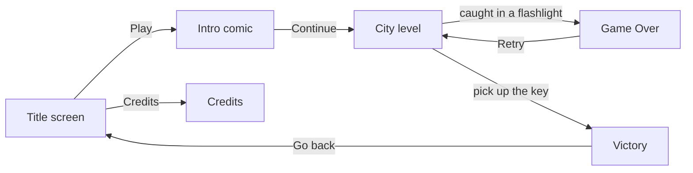

# Food Guardians

**A top-down 2D pixel-art game made in Godot 4.3 for UAE Game Makers, reworked from the Global Game Jam 2024 game *High & Dry*.**


## Overview

Food Guardians drops you into a darkened city. You pick up food along the way, pass people who react as you walk up, stay out of the police officers' flashlights and look for the key that ends the run. It was made for UAE Game Makers on top of the Godot project of *High & Dry*, so much of the code, art and audio (and the Spanish names of scenes and scripts) comes from that game.

The repository name is left over from an earlier prototype, *RhythmGuardians*, which this project replaced in April 2025.

## Features

- **Title screen** with Play, Credits and Exit, and menu music.
- **Intro comic:** six illustrated panels with sound; a Continue button appears after six seconds.
- **City level:** a tile-map city darkened with a `CanvasModulate` and lit by 40 point lights, with background music.
- **Patrolling police:** three officers walk back and forth and turn around when their raycast sensors hit an obstacle. Each carries a flashlight, and walking into its light ends the game.
- **Pickups:** empanadas, candies, flowers and mate each play their own sound and disappear when collected.
- **NPCs** show a speech bubble and a small "talking" bounce when you walk up; some of them thank you for the food.
- **The key:** picking it up takes you to the Victory screen.
- **Menus:** pause (Resume, Menu, Quit), Game Over with Retry, Victory, and a Credits screen.
- **Export presets** for Web, Windows Desktop and Linux/X11.



## Controls

| Action | Keyboard | Gamepad |
|---|---|---|
| Move | W A S D or arrow keys | D-pad or left stick |
| Pause | Esc | |

## Tech Stack

- **Engine:** Godot 4.3, GL Compatibility renderer, nearest-neighbour texture filtering for crisp pixel art
- **Language:** GDScript
- **Add-on:** [Dialogue Manager](addons/dialogue_manager) 2.32.3 (used by the dialogue scenes inherited from *High & Dry*)
- **Font:** VT323

## Getting Started

1. Install **Godot 4.3** (the standard build is enough; the project has no C# project file).
2. Clone the repository:
   ```bash
   git clone https://github.com/4waiz/RhythmGuardians-main.git
   ```
3. In the Godot Project Manager choose **Import**, select `project.godot`, then press **F5** to run. The main scene is `scenes/Splash/control.tscn`.
4. To build, install the Godot 4.3 export templates and use **Project > Export**. The presets still point at `../Exports/GGJ2024/...` from the base game, so change the export paths first.

## Project Structure

```
RhythmGuardians-main/
├── project.godot              # project "Food Guardians"; input map and autoloads
├── scenes/
│   ├── Splash/  Splash2/      # title screen and credits
│   ├── cinematica/            # intro comic
│   ├── nueva_ciudad.tscn      # the city level
│   ├── player.tscn  polcia.tscn  NPC_monedita/  Npc_OfficeWorker/
│   ├── empanada.tscn  caramelos.tscn  flores.tscn  mate.tscn  llave.tscn
│   └── pausa/  Muerte/  victoria/   # pause, game over, victory
├── scripts/                   # player, police, pickups, camera shake, level logic, autoload
├── dialogues/                 # Dialogue Manager files (Spanish, from the base game)
├── assets/  sounds/  fonts/   # sprites, tiles, menu art, music and effects, VT323
└── addons/dialogue_manager/
```

## Notes

- The house conversations in `scripts/nueva_ciudad.gd` (the **E** interact key and the Dialogue Manager balloons) come from *High & Dry*. The current city level has no house areas connected to them, so they cannot be reached in play.
- Folder, scene and script names are mostly Spanish because they come from the base project.

## Team and Credits

| Name | Role (from the in-game credits) |
|---|---|
| Awaiz Ahmed | Game Developer |
| Kazi Mahir | Game Designer |

Commits by [@4waiz](https://github.com/4waiz) and [@kmaw007](https://github.com/kmaw007).

- **Base game:** [*High & Dry*](https://zhea606.itch.io/highanddry), made for the Global Game Jam 2024. This project builds on its Godot source, art, music and sound effects.
- **Dialogue Manager** by Nathan Hoad and contributors, MIT License (`addons/dialogue_manager/LICENSE`).
- **VT323** font by The VT323 Project Authors, SIL Open Font License 1.1 (`fonts/VT323/OFL.txt`).
- The hiccup sound `sounds/428635__lipalearning__male-hiccup.wav` is named like a Freesound download (#428635 by lipalearning).

---

Built by [Awaiz Ahmed](https://github.com/4waiz) with Kazi Mahir for UAE Game Makers.
